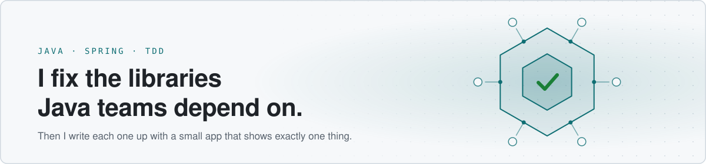

<picture>
  <source media="(prefers-color-scheme: dark)" srcset="assets/banner-dark.svg">
  <source media="(prefers-color-scheme: light)" srcset="assets/banner-light.svg">
  
</picture>

Software developer at THG in Bournemouth, England. MSc Computing Science (Distinction), University of Southampton.

I work mostly in Java and Spring, test-first. Lately I've been sending fixes upstream to open-source libraries I use, and writing up what I learn with small apps that each demonstrate exactly one thing.

[Website](https://www.sharanggupta.dev) · [Writing](https://sharanggupta.medium.com) · [LinkedIn](https://www.linkedin.com/in/sharanggupta/)

---

## Merged upstream

Fixes that landed in projects I use.

| Project | Change |
|---|---|
| [Spring Cloud Stream](https://github.com/spring-cloud/spring-cloud-stream/pull/3296) | `DefaultBinderFactory` no longer starts plain lifecycle beans in binder contexts during a normal refresh (gh-3155). Backported to 5.0.x. |
| [Apache Commons Lang](https://github.com/apache/commons-lang/pull/1812) | `TypeUtils.containsTypeVariables` and `unrollVariables` honour the owner type of a `ParameterizedType` (LANG-1836). |
| [Micronaut Core](https://github.com/micronaut-projects/micronaut-core/pull/13801) | An `Accept-Charset` header is ignored when reading `String` request bodies. |
| [SpotBugs](https://github.com/spotbugs/spotbugs/pull/4377) | `RV_RETURN_VALUE_IGNORED_NO_SIDE_EFFECT` now reports an ignored `Arrays.copyOf` result. |
| [ArchUnit](https://github.com/TNG/ArchUnit/pull/1747) | New `haveOnlyFinalNonSyntheticFields()` condition that skips compiler-generated fields. |
| [OpenFeign](https://github.com/OpenFeign/feign/pull/3605) | A `null` `Request.Body` is treated as a request with no body. |

More are in review: [open pull requests](https://github.com/pulls?q=is%3Apr+author%3Asharanggupta+is%3Aopen+-user%3Asharanggupta).

## Selected projects

- **[eventcore](https://github.com/sharanggupta/eventcore)**: a self-hosted event audit log with signed, retried webhook delivery. Java, TimescaleDB, CI.
- **[hexagonal-orders](https://github.com/sharanggupta/hexagonal-orders)**: a Java 21 walk from controller-service-repository to hexagonal architecture, one failing test at a time. Module boundaries are enforced by the build.
- **[flight-search](https://github.com/sharanggupta/flight-search)**: a Spring Boot REST API built test-first with a hexagon that never depends on the outside at compile time.
- **[eazybank](https://github.com/sharanggupta/eazybank)**: reactive Spring Boot microservices with an API gateway and distributed tracing.
- **[oauth2product](https://github.com/sharanggupta/oauth2product)**: OAuth2 resource server and client with Spring Boot, built test-first. The article series below follows this code.

## Writing

A four-part series on OAuth2 with Spring Boot, each part with a working app:

1. [Demystifying OAuth2](https://sharanggupta.medium.com/demystifying-oauth2-a-step-by-step-guide-to-building-a-resource-server-with-spring-boot-tdd-6da6912411a5)
2. [Building an OAuth2 Resource Server](https://sharanggupta.medium.com/building-an-oauth2-resource-server-in-spring-boot-tdd-621a34999410)
3. [Building an OAuth2 Client](https://sharanggupta.medium.com/part-3-building-an-oauth2-client-in-spring-boot-tdd-91b0ba8ee5ae)
4. [Running the System End-to-End](https://sharanggupta.medium.com/part-4-running-the-system-end-to-end-spring-multi-module-docker-86a41a128e46)

---

Day-to-day work at THG lives in private repositories; my work account is [@sharang-gupta-thg](https://github.com/sharang-gupta-thg).
